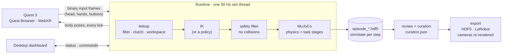

# xrcollect

**Collect robot manipulation demonstrations in VR.** Put on a Meta Quest 3, drive simulated Franka arms in
MuJoCo with the controllers or your bare hands, and get a lossless, replayable, labelled dataset out, ready for
imitation learning (raw HDF5 or LeRobot), with camera images rendered after the fact.

## Quick run

**Run it:**

```bash
./scripts/install.sh          # install everything (once)
uv run xrc doctor             # check the setup
uv run xrc serve              # start the server with the default task
```

Then open the printed URL. On a Quest:

```bash
uv run xrc setup-quest        # USB: forward the port, then serve as above
uv run xrc certs              # Wi-Fi: create the HTTPS certificate once, then serve as above
```

**Optional: edit a task's scene.** Edits rewrite the task file, so work on a copy:

```bash
mkdir -p scratch
cp -r tasks/stack_cups scratch/task
uv run xrc serve --task scratch/task --out scratch/data
```

- Dashboard: open the **Scene** tab, turn on edit mode, then use the forms or drag cups in the 3D view (W move, E turn).
- Headset: wrist menu → **Tools → Edit scene**, grab with Trigger, press **Apply**.

Check what changed and whether the task is still solvable:

```bash
git diff --no-index tasks/stack_cups/task.yaml scratch/task/task.yaml
uv run xrc validate-task scratch/task --n 5
```

Note: `stack_cups` is a plugin task. `task.py` places the cups at random spots from `params.spawn` on every reset, so
moving a cup in the editor doesn't change where it starts. Edit `params` in `task.yaml` instead.

**Optional: export, look at and train on your episodes.** Recorded takes are in `data/episodes/`.

```bash
uv sync --extra lerobot --extra train          # once (brings torch); name every extra you want each time

# Export to LeRobot (cup task cameras, 25 fps) -> data/exports/cups_v1
uv run xrc export cups_v1 --exporter lerobot --cameras left,right,cam_wrist --fps 25

# Look at episode 0 in Rerun (play the `timestamp` timeline)
uv run lerobot-dataset-viz --repo-id xrcollect/cups_v1 --root data/exports/cups_v1 --episode-index 0

# Train ACT -> outputs/train/act_cups_v1 (10% of the episodes held out for eval_loss)
uv run lerobot-train --dataset.repo_id=xrcollect/cups_v1 --dataset.root=data/exports/cups_v1 \
  --dataset.eval_split=0.1 --eval_steps=2000 \
  --policy.type=act --policy.device=cuda --policy.push_to_hub=false \
  --batch_size=8 --steps=100000 --save_freq=20000 \
  --output_dir=outputs/train/act_cups_v1 --job_name=act_cups_v1

# Success rate of a checkpoint on 50 fresh start layouts, headless (n_action_steps=50: a new chunk every 2 s at 25 fps)
uv run xrc rollout xrcollect.policies.lerobot:LeRobotRunner --policy-arg checkpoint=outputs/train/act_cups_v1 \
  --policy-arg n_action_steps=50 --n 50 --video outputs/eval/act_cups_v1/videos
```

Details: [Exporting](#exporting) (frame rate, viewing every episode at once), [Training a policy](#training-a-policy)
and [docs/training.md](docs/training.md) (losses, validation split, comparing checkpoints, resuming, Hub upload).

<table>
  <tr>
    <td></td>
    <td></td>
    <td></td>
  </tr>
  <tr>
    <td align="center"><code>stack_two_blocks</code> · bimanual</td>
    <td align="center"><code>duplo_tower</code> · press-fit snapping</td>
    <td align="center"><code>open_drawer</code> · single arm, articulated fixture</td>
  </tr>
</table>

<sub>Three of the bundled tasks, solved here by the built-in scripted expert (`xrc validate-task`) on the same control
stack a human operator uses. A fourth, `stack_cups` (single arm: put the red cup into the green one), is
mujoco_toy-project's task migrated as a plugin task. Every task is also a [Gymnasium environment](#reinforcement-learning-gymnasium).</sub>

## Why

Teleoperating a real robot for demonstrations is slow, expensive and hard to reproduce. xrcollect moves the whole
loop into simulation and into the headset:

- **Natural input.** 6-DoF controllers or hand tracking, a clutch so you can reposition your hand, motion scaling,
  a seated mode. Haptics and sound tell you when you grasp, place, snap or succeed.
- **Lossless recording.** Every step stores the full simulator state, so a take replays bit-exactly. Nothing is
  thrown away: raw head and hand poses (25 joints per hand) are kept too, so data can be re-retargeted later.
- **Images are rendered, not recorded.** Pick cameras, resolution and visual randomization at export time and
  re-render the whole dataset from the stored states. Add a camera next month; old takes get it too.
- **Review without taking the headset off.** A review card after every take shows whether the dataset would keep
  it and why; label success, quality and tags, then save or discard from your hands. Replay the take at 1:1 scale
  in VR and *take over* from any frame to record a correction.
- **A task is data.** Robot, scene, objects and success stages are YAML; an optional Python plugin covers the
  rest. Adding a task never touches platform code, and every episode carries its own task definition.
- **One set of curation rules.** Idle trimming, contact rejection, failed takes and stage cut-offs are decided in
  one place and used by the review card, the episode list and every exporter alike.

## How it works



The server (Python, FastAPI) owns the simulation. The headset page and the dashboard (TypeScript, three.js,
React) are thin clients: they draw the scene from streamed body poses and send every action as a command.

## Screenshots

<table>
  <tr>
    <td width="50%"><br>
      <sub><b>In the headset.</b> HUD with recorder state, stages, session counters and link quality; the goal
      panel; labels next to each controller button. The right arm is engaged (glow, status chip).</sub></td>
    <td width="50%"><br>
      <sub><b>Wrist menu</b> (Y). Input mode, record and save, recenter, motion scale, panels; a Layout page for
      camera previews and panel placement; a Tools page for replay, scene editing, hand mapping and comfort.</sub></td>
  </tr>
  <tr>
    <td width="50%"><br>
      <sub><b>Review card</b> after every take: what a dataset would do with it and why, success, quality stars,
      tags, save or discard.</sub></td>
    <td width="50%"><br>
      <sub><b>Landing page</b> in Quest Browser: pick controllers or hands, then enter VR or mixed reality
      (passthrough).</sub></td>
  </tr>
  <tr>
    <td width="50%"><br>
      <sub><b>Dashboard · Record.</b> Live 3D view, camera previews, the goal and its stages, arm status.</sub></td>
    <td width="50%"><br>
      <sub><b>Episodes.</b> Every take with its verdict; replay with a timeline, label, exclude, take over.</sub></td>
  </tr>
  <tr>
    <td width="50%"><br>
      <sub><b>Scene.</b> The task editor: drag objects with a gizmo, edit properties, regions, cameras and stages,
      capture the goal. Edits are written back into the YAML and hot-reload in both clients.</sub></td>
    <td width="50%"><br>
      <sub><b>Data.</b> Dataset health and start-position coverage next to the export form, with a live preview of
      what would be exported.</sub></td>
  </tr>
</table>

## Contents

- [Quick start](#quick-start)
- [Running a session](#running-a-session)
- [Controls](#controls)
- [The dashboard](#the-dashboard)
- [Writing a task](#writing-a-task)
- [Data format](#data-format)
- [Exporting](#exporting)
- [Training a policy](#training-a-policy)
- [Driving with a policy](#driving-with-a-policy)
- [Reinforcement learning (Gymnasium)](#reinforcement-learning-gymnasium)
- [Command reference](#command-reference)
- [Development](#development)

Developers: see [docs/architecture.md](docs/architecture.md) for threads, the control tick, the wire protocol and
the HTTP endpoints. Training and evaluating a policy, step by step: [docs/training.md](docs/training.md).

## Quick start

You need Linux with `git` and `curl` (or `wget`), and a GPU driver or Mesa that provides EGL for offscreen
rendering. For a USB connection to the headset you also need `adb`. The headset is a Meta Quest 3 (other WebXR
headsets with controllers or hand tracking should work but are untested).

```bash
git clone https://github.com/HarunSMetin/MetaQuestDataCollector.git
cd MetaQuestDataCollector
./scripts/install.sh                # everything below, in one go; then:
uv run xrc serve                    # open the headset page (below) and http://localhost:8000/dashboard/
```

`install.sh` needs no sudo and is safe to re-run. It:

1. installs [uv](https://docs.astral.sh/uv/) for your user if it is missing (uv then brings Python 3.12);
2. uses your Node.js if it is 20.19+ or 22.12+, otherwise downloads Node 22 LTS into `.tools/node` inside the repo
   (checksum-verified; Node is only needed to build the web client);
3. fetches the Franka Panda model from MuJoCo Menagerie into `assets/third_party/`;
4. creates `.venv` with `uv sync` and builds the web client into `web/dist`;
5. runs `uv run xrc doctor` and, if offscreen rendering fails, prints the package to install
   (`sudo apt install libegl1 libgl1 libgles2`, or `libosmesa6` with `MUJOCO_GL=osmesa` on machines without a GPU).

Options: `--lerobot` (LeRobot exporter, brings torch), `--mesh` (`xrc import-mesh`), `--e2e` (Playwright and
Chromium for the headset-free tests), `--all`, `--yes` (no questions), `--no-doctor`.

<details>
<summary>Manual install (what the script does)</summary>

```bash
./scripts/fetch_assets.sh           # Franka model from mujoco_menagerie -> assets/third_party/
uv sync                             # add --extra lerobot for the LeRobot exporter + viewer (brings torch)
                                    # add --extra train for `lerobot-train` (training a policy on an export)
                                    # add --extra mesh for `xrc import-mesh`
                                    # name every extra you want each time: uv sync drops the others
(cd web && npm ci && npm run build) # needs Node 20.19+ / 22.12+; the server serves web/dist
uv run xrc doctor                   # checks assets, EGL, the web build, protocol files, adb
```

</details>

No headset at hand? `uv run xrc view tasks/stack_two_blocks` opens a task in a desktop viewer, and
`uv run xrc validate-task tasks/stack_two_blocks` watches the scripted expert solve it.

## Running a session

```bash
uv run xrc serve                              # the task from config.yaml
uv run xrc serve --task tasks/duplo_tower     # another task
uv run xrc serve --mode hands                 # start in hand-tracking mode
uv run xrc serve --out data/session_02        # write takes somewhere else
```

There are two ways to connect the headset:

- **USB (simplest).** Enable developer mode on the Quest and plug it in. Run `uv run xrc setup-quest`, which sets up
  an adb reverse port forward; run it again after replugging. Then open `http://localhost:8000/xr/` in Quest Browser.
- **Wi-Fi.** WebXR needs HTTPS off localhost. Run `uv run xrc certs` once, start `xrc serve`, and open the printed
  `https://<lan-ip>:8443/xr/`. Accept the self-signed certificate.

Open the dashboard on the desktop at `http://localhost:8000/dashboard/`. In the headset press **Enter VR**, or
**Enter Mixed Reality** to see the simulated table in your room (passthrough).

A take goes like this:

1. Press **A** (record). After a 3 s countdown the recording starts.
2. Do the task. When success holds for a second, the take stops by itself; you can also press **A** to stop.
3. The review card shows what will be kept and why. Set success, tags and a quality score, then save (**X**) or
   discard (**B**).

## Controls

Controller buttons are served by the server (`GET /api/commands`). The headset shows them as labels on the
controller models; turn them off with *Button hints* in the wrist menu.

| Input | Action |
| --- | --- |
| **Grip** (either hand) | Toggle: that hand moves its arm (clutch). Release, reposition, grip again to keep going. |
| **Trigger** | Close the gripper (analog) |
| **A** (right) | Record / stop, or cancel during the countdown |
| **B** (right) | Discard the take |
| **X** (left) | Save the take |
| **Y** (left) | Wrist menu |
| **Left stick press** | Recenter the robots in front of you |
| Ray + Trigger | Press panel buttons; grab a panel by its title bar, then push or pull it with the stick |

**Hands mode:** curl your middle, ring and little finger into your palm and open them again to toggle the
clutch (one curl = one toggle; index and thumb stay free). The thumb–index distance sets the gripper, and it holds
still while the three fingers are curled, so the gesture never drops or grabs anything. Look at your left palm for
the menu. If the gesture triggers too easily or not at all on your hands, tune `teleop.curl_on` / `curl_off`.

**Control modes** (wrist menu → Tools, or `teleop.control` in `config.yaml`):

| Mode | The arm's target |
| --- | --- |
| `clutched` (default) | where it was when you engaged, plus your hand's motion since, times the motion scale. Like lifting a mouse. |
| `absolute` | your hand: the gripper goes where the hand is |
| `rate` | moves with a velocity proportional to the hand's offset from where you engaged; for large workspaces |

In every mode the hand's rotation since engaging is applied to the gripper, so re-engaging never makes it jump.

**Wrist menu:**

- **Main:** input mode (controllers or hands), record, save as success or failure, discard, recenter, speed
  (motion scale), new scene, sound, button hints, camera view, camera previews.
- **Layout:** which camera previews show and how (column, row, grid); which panels show (status, goal, previews)
  and whether each stays in the world, follows your body or rides on your wrist; lock panels or reset the layout.
- **Tools:** replay the last take (opens the timeline: play, pause, seek, speed, step, *take over here*) or show
  its ghost; edit the scene (move objects, capture the goal); goal guide; swap hands (left-handed use, or both
  hands on one arm); control mode; table height (seated preset).

The headset gives feedback as haptics and sound cues on grasp, release, stage reached, snap clicks and success.
The safety filter buzzes when it has to change a joint target (an arm about to hit the table or the other arm).
It never helps with the task.

## The dashboard

- **Record**: a live 3D view, camera previews, the goal and its stages, session counters, record controls, the
  operator name and auto-stop.
- **Episodes**: every take with its verdict (kept, cut, or left out, and why). Replay a take in the headset, label
  it (success, tags, quality, time annotations), or exclude it. Labels go to `curation.json` next to the episodes,
  and the episode files are never rewritten.
- **Policy**: load a policy runner, run it, share control, or stop it. Record its rollouts like any other take.
- **Scene**: the task editor. Switch tasks from the list at the top. In edit mode physics pauses:
  - Click an object in the 3D view and drag the gizmo (**W** to move, **E** to turn). **Apply moves** writes the new
    poses into the task file.
  - Edit an object's asset, mass, friction, colour and start region. Add or remove objects, regions and cameras.
  - Edit the stages and success predicate.
  - **Capture goal** records the current arrangement as the goal: it adds `*_placed` stages and a goal view.

  Each edit is written into the YAML (comments kept) and the scene reloads in both clients.
- **Data**: dataset health (takes, success rate, usable time, mixed task versions) and start-position coverage per
  object, plus take durations, success over time, contacts and operators. Next to it is the export form, with a
  live preview of what would be exported.

## Writing a task

A task folder holds `task.yaml`, plus an optional `task.py` plugin and `expert.py`. It references four layers:

| Layer | Where | What |
| --- | --- | --- |
| embodiment | `embodiments/*.yaml` | robot adapter, arms and mounts, home pose, limits, safety margins |
| scene | `scenes/*.yaml` | table, props, lights, cameras |
| objects | `objects/**.yaml` | reusable assets: shape, size, mass, friction, geoms (or a builder / MJCF / mesh) |
| task | `tasks/<name>/task.yaml` | which objects, regions, start distribution, stages, success, events, goal view |

Two embodiments ship: `franka_bimanual` (two Franka Panda arms) and `franka_single`. A complete task
(`tasks/stack_two_blocks/task.yaml`):

```yaml
task: stack_two_blocks
instruction: "Put the red block in the taped area, then the blue block on top of it."
embodiment: franka_bimanual
scene: table
objects:
  red_block:  {asset: blocks/cube_4cm, rgba: [0.85, 0.1, 0.1, 1], mass: 0.05, label: red block}
  blue_block: {asset: blocks/cube_4cm, rgba: [0.1, 0.3, 0.9, 1], mass: 0.05, label: blue block}
regions:                     # named areas, drawn as tape (visible to the cameras)
  build_area: {center: [0.50, 0.0], half: [0.06, 0.06]}
spawn:                       # start-state distribution, per object
  red_block:  {region: {center: [0.42, 0.22], half: [0.04, 0.04]}, yaw_deg: [-15, 15]}
  blue_block: {region: {center: [0.42, -0.22], half: [0.04, 0.04]}, yaw_deg: [-15, 15]}
stages:                      # ordered progress; each is a predicate over the simulator state
  - name: red_in_area
    label: red block in the area
    when: {all: [{inside: {object: red_block, region: build_area}}, {upright: red_block}]}
  - name: blue_on_red
    label: blue block on the red block
    when: {all: [{stage: red_in_area}, {on_top: {object: blue_block, base: red_block, tol_xy: 0.012, tol_z: 0.004}}]}
success:                     # omit: all stages done, nothing held, everything at rest
  all: [{stage: blue_on_red}, {not_held: any}, {at_rest: {objects: all, max_speed: 0.02}}]
events:                      # task feedback -> cues (config.yaml feedback.cues)
  - {on: stage_reached, cue: placed, toast: "{stage}"}
  - {on: success, cue: complete}
goal_view:                   # what the goal panel draws, relative to the anchor object
  anchor: red_block
  show:
    - {object: blue_block, pose: {pos: [0, 0, 0.04], yaw: 0}}
```

World frame: z up, +x away from the operator, +y to the operator's left, metres. An object's body frame is the
bottom centre of its bounding box.

**Predicates** (`xrcollect/task/predicates.py`; the Scene tab lists them with templates):

| Predicate | Holds when |
| --- | --- |
| `inside` | the object's whole footprint lies inside a region |
| `on_top` | the object rests on top of the base object, centred within `tol_xy` |
| `pose_near` / `relative_pose` | the object is at a world pose / at a pose in the base object's frame |
| `contact` | two bodies touch (objects, `table`, `arm:<arm>`, `gripper:<arm>`) |
| `held` / `not_held` | the object is (not) held, optionally `by` an arm; `not_held: any` = hands empty |
| `at_rest` | the objects move slower than `max_speed` |
| `joint_at` | a fixture joint (drawer, door) is at a value, or beyond `min` / `max` |
| `upright` | the object's z axis points up |
| `snapped` | the press fit between two objects is engaged |
| `count` | at least `min` (at most `max`) of the objects satisfy `when` (`$` is the object) |
| `all` / `any` / `not` / `stage` | combinators; `stage` refers to an earlier stage |

Predicates must depend on the simulator state only, because replay, review and export recompute them from
recorded states.

Test the success check on the cases it must accept and reject, not only on the scripted expert: a nested cup turned
either way about its axis, an object resting at an angle, one held in the air. A check that is too strict
mislabels good takes and makes every policy rollout look worse; after fixing one, re-run the rollouts (rollout
files keep the check they were recorded with).

**Objects** live in a shared library, referenced as `asset:`. A box is a few lines:

```yaml
# objects/blocks/cube_4cm.yaml
label: cube
shape: box
size: [0.04, 0.04, 0.04]     # bounding box x, y, z
mass: 0.05
friction: 0.8
rgba: [0.7, 0.7, 0.7, 1]
geoms:
  - {type: box, size: [0.02, 0.02, 0.02], pos: [0, 0, 0.02]}
```

You can also build an object procedurally with `builder: brick.py:brick` and `builder_args` (see
`objects/duplo/`), use an MJCF fixture with joints (`objects/furniture/drawer.yaml`), or import a mesh with
`uv run xrc import-mesh mug.obj kitchen/mug`, which splits it into convex pieces. A task can override `mass`,
`friction`, `rgba`, `label` and `builder_args` per object.

**Press fits** (DUPLO-style) are welds that switch on when two parts touch, line up and are pressed together, and
switch off when pulled apart hard enough (`pull_n`). See `tasks/duplo_tower`.

**Plugins**: for logic YAML can't express, `plugin: task.py:MyTask` subclasses `DeclarativeTask`
(`xrcollect/task/declarative.py`). Override `build` / `bind` / `reset` / `stage_flags` / `after_step` and so on.
Any state the plugin keeps outside MuJoCo must go through `extra_state` / `set_extra_state`, or replays will
diverge. `tasks/duplo_tower/task.py` is the worked example: a stud-grid snap test and a tower that may stand either
way round.

**Check a task** before collecting with it:

```bash
uv run xrc view tasks/my_task              # look at it (and its start distribution)
uv run xrc validate-task tasks/my_task     # a scripted expert must reach success, from several seeds
```

The expert plans pick-and-place moves from the stages. For anything else, write `expert.py` with
`def script(expert)` (see `tasks/open_drawer/expert.py`).

Every edit changes the task's `task_version`, a hash of all four layers. Episodes store their whole task bundle and
compiled scene, so old takes still replay after you change the task. Exports refuse to mix versions unless you pass
`--allow-mixed`.

## Data format

One HDF5 file per take: `<record.out_dir>/episode_XXXXXX.hdf5` (default `data/episodes/`). Time is axis 0;
`n` = arms, `J` = joints per arm, `k` = objects. Images are not stored: `sim/state` replays the take exactly, and
exporters render cameras from it.

| Key | Shape | Content |
| --- | --- | --- |
| `time`, `wall_time` | (T,) | sim time, host time [s] |
| `obs/joint_pos`, `obs/joint_vel` | (T, n·J) | arm order = attr `arms` |
| `obs/gripper_width` | (T, n) | finger opening [m] |
| `obs/ee_pose` | (T, n, 7) | TCP `[x y z qw qx qy qz]`, world |
| `obs/ee_wrench` | (T, n, 6) | external force [N] and torque [Nm] on each hand |
| `obs/objects` | (T, k, 7) | object poses (privileged), order = attr `objects` |
| `obs/fixture_joints` | (T, f) | drawer / door joints |
| `action/joint_pos` | (T, n·(J+1)) | per arm: J joint targets + gripper (0 closed … 1 open), after the safety filter |
| `action/ee_pose` | (T, n·7+n) | the TCP poses of those targets, plus grippers |
| `sim/state` | (T, S) | full simulator state before each step (MuJoCo + task extra state) |
| `task/success`, `task/progress` | (T,) | success flag, stages done |
| `task/stages` | (T, s) | each stage's predicate, order = attr `stage_names` |
| `task/held` | (T, n) | object index held by each arm (−1: none) |
| `contacts` | (T, 3) | link–table, arm–arm, fingertip–table contact, order = attr `contact_kinds` |
| `control/source` | (T,) | who drove: 0 operator, 1 policy, 2 script |
| `safety/correction` | (T,) | largest joint-target change the safety filter made [rad] |
| `teleop/*` | … | raw XR head and hand poses, buttons, 25 hand joints, pinch, engaged, tracked, RTT, input rate |

File attributes include `schema_version`, `task`, `task_version`, `instruction`, `operator`, `session`,
`input_mode`, `source`, `success`, `fps`, `seed`, `model_xml`, `task_yaml` (the resolved task bundle),
`config_yaml`, `action_names` and `stage_names`. The full list, with branching and derived-episode fields, is in the
docstring of `xrcollect/recorder.py`.

`uv run xrc inspect ep.hdf5` prints a summary. `uv run xrc resim ep.hdf5` replays the recorded actions from the
first state and checks the result matches.

Manual labels (success override, tags, quality, notes, exclusions, time annotations) live in `curation.json` in the
same folder. Labels never touch the episode files.

**DART noise** (`record.action_noise`) perturbs the executed targets, not the recorded ones, so the operator's
corrections end up in the data. The executed targets can be recovered from `sim/state`.

## Exporting

Which steps make it into a dataset is decided in one place, the `curate` section of `config.yaml`. The review
card, the Episodes tab and every exporter use the same rules:

- Failed takes are left out unless `include_failures` is set.
- Idle time at the start and end is trimmed.
- Takes with too much table or arm contact are rejected, or just the contact moments are cut out.
- For shared-control takes, only the operator's steps are kept.
- A take can be cut at a given stage.

```bash
uv run xrc export my_set                                   # raw HDF5 with images -> data/exports/my_set
uv run xrc export my_set --exporter lerobot --cameras cam_high,cam_left_wrist
uv run xrc export my_set --cameras none --annotations      # state only; time annotations as segments
```

<p align="center"><br>
<sub>The scene cameras (<code>cam_high</code>, <code>cam_low</code>, both wrists) as an exporter renders them from
<code>sim/state</code>: flat, matte light, no shadows or operator aids. Optional per-episode visual randomization
varies lighting, colours and camera mounts.</sub></p>

You can also export from the Data tab. Every export writes `xrcollect_manifest.json`: its feature layout, the
episodes and spans used, the curate rules and the git commit. Channels that never change are flagged, since a
policy input normalized by ~0 blows up at run time. The `lerobot` exporter needs `uv sync --extra lerobot`.

**Frame rate.** A dataset has one frame per control tick, so its fps is the scene's `physics.control_hz` (50 by
default; physics itself steps at 500 Hz). Images are rendered per frame from that frame's state, so cameras and
joints always line up. To match a robot that runs its policy at another rate, export with `--fps`: `--fps 25`
keeps every second step of a 50 Hz recording, with each frame's action the last target before the next frame. The
rate must divide the recording's (50 → 50, 25, 10, ...). `LeRobotRunner` reads it from the manifest and asks the
policy at that rate. Recording at another rate instead means setting `control_hz` in the scene, which makes a new
task version; don't mix those episodes.

### Looking at a LeRobot export

LeRobot's viewer ([Rerun](https://rerun.io)) shows the camera videos and the joint and action plots of one episode:

```bash
uv run lerobot-dataset-viz --repo-id xrcollect/my_set --root data/exports/my_set --episode-index 0
```

To browse every episode in one window, save them as `.rrd` files and open them together:

```bash
for i in $(seq 0 48); do      # 0 .. number of episodes - 1
  uv run lerobot-dataset-viz --repo-id xrcollect/my_set --root data/exports/my_set \
    --episode-index $i --save 1 --output-dir data/exports/my_set_rrd
done
uv run rerun data/exports/my_set_rrd/*.rrd
```

Use `uv run rerun`, not a `rerun` on your PATH (an unrelated Ruby tool has the same name), and no `sudo`. In the
viewer, play the `timestamp` timeline: `frame_index` plays at the viewer's own rate, not the dataset's fps.

## Training a policy

Training is not part of xrcollect, but a LeRobot export trains with LeRobot directly. For example ACT, on every
camera in the export:

```bash
uv sync --extra lerobot --extra train
uv run lerobot-train \
  --dataset.repo_id=xrcollect/my_set --dataset.root=data/exports/my_set \
  --policy.type=act --policy.device=cuda --policy.push_to_hub=false \
  --batch_size=8 --steps=100000 --save_freq=20000 \
  --output_dir=outputs/train/act_my_set --job_name=act_my_set
```

- `--policy.push_to_hub=false`: the default uploads the model to the Hugging Face Hub.
- Add `--dataset.eval_split=0.1 --eval_steps=2000` to hold out 10% of the episodes (whole episodes, the last ones
  by index) and log `eval_loss` on them. It's open-loop, so use it to spot overfitting and success rate to judge
  the policy.
- Checkpoints land in `outputs/train/<name>/checkpoints/`. Use a new `--output_dir` for each run.
- Experiment tracking is Trackio (LeRobot 0.7+; the old `--wandb.*` options are gone), off by default: add
  `--trackio.enable=true` and view it with `uv run trackio show --project lerobot`. Runs stay local.
- ACT predicts `chunk_size` (default 100) actions at once: 2 s at 50 fps, 4 s at 25 fps.
- As a rough guide, on an 8 GB laptop GPU with three 224×224 cameras a step at batch size 8 took about 0.1 s and
  under 2 GB of GPU memory.

To train further, or resume a stopped run, start from a checkpoint's config with the new total of steps:

```bash
uv run lerobot-train --resume=true --steps=200000 \
  --config_path=outputs/train/act_my_set/checkpoints/100000/pretrained_model/train_config.json
```

### Evaluating in sim

`eval_loss` can't tell whether a policy works, so measure the success rate of each checkpoint in sim. `xrc rollout`
runs it headless (no server, no headset) through the same safety filter and control step as a live session, on
start layouts that are never in the recorded data and are the same for every run (here a 25 fps export):

```bash
uv run xrc rollout xrcollect.policies.lerobot:LeRobotRunner \
  --policy-arg checkpoint=outputs/train/act_my_set/checkpoints/100000 --policy-arg n_action_steps=50 \
  --n 50 --out outputs/eval/act_my_set/100000.json \
  --save outputs/eval/act_my_set/episodes --video outputs/eval/act_my_set/videos
```

- **Output:** one line per episode (`success` / `fail`, time, furthest stage), then `success 25/50 (50%)`.
  `--out` writes the same per episode as JSON.
- **Watching:** `--video` writes one MP4 per episode named by result (`ep003_fail.mp4`); `--save` writes episode
  files: `uv run xrc replay <file>`, or `uv run xrc serve --out <dir>` to browse them in the Episodes tab.
- **`n_action_steps`:** ACT runs this many actions of each predicted chunk before predicting again. Re-planning
  every ~2 s (`50` at 25 fps, the default `100` at 50 fps) did best on the cup task; the full 4 s chunk at 25 fps
  did markedly worse.
- **How many episodes:** 20 is a rough look; use 50 or more to compare checkpoints (a rate near 50% over 50
  episodes is ±14%). GPU inference isn't bit-exact, so reruns differ slightly.
- **For reference:** ACT trained on 108 cup-stacking demonstrations reaches 47–50% (25 fps, 100k steps). Training
  to 200k didn't improve it; more demonstrations, or corrections recorded in shared mode, are what help.

Losses, the runner's options and a worked comparison of checkpoints: [docs/training.md](docs/training.md).

### Sharing on the Hugging Face Hub

```bash
uv run hf auth login     # once, with a write token
uv run python -c "from lerobot.datasets.lerobot_dataset import LeRobotDataset as D; \
  D('<user>/my_set', root='data/exports/my_set').push_to_hub(private=True)"
uv run hf upload <user>/act_my_set \
  outputs/train/act_my_set/checkpoints/100000/pretrained_model --repo-type model --private
```

The dataset upload includes `xrcollect_manifest.json`, which the runner needs. Details in
[docs/training.md](docs/training.md#6-share-on-the-hugging-face-hub).

## Driving with a policy

A policy runner is any class with `reset(env)` and `act(env) -> (joint targets, grippers)`; see
`xrcollect/policy.py`. xrcollect imports no ML library itself; the bundled `LeRobotRunner`
(`xrcollect/policies/lerobot.py`) imports LeRobot only when it's loaded, and runs a LeRobot checkpoint with the
inputs its export was built with. Load a runner at start-up, or from the Policy tab (ref plus JSON args):

```bash
uv run xrc serve --policy xrcollect.policies.lerobot:LeRobotRunner \
  --policy-arg checkpoint=outputs/train/act_my_set --policy-arg n_action_steps=50 --control shared   # 25 fps export
uv run xrc serve --policy my_pkg.policies:Runner              # your own; or path/to/file.py:Runner
```

The control modes:

- **Run**: the policy drives.
- **Shared**: the policy drives until you press Grip, then you do (DAgger-style corrections).
- **Stop**: you drive.

Policy actions go through the same safety filter. Each recorded step says who drove. A policy can check its
expected feature layout against the export manifest it was trained on.

## Reinforcement learning (Gymnasium)

Every task is registered as a Gymnasium environment, `xrcollect/<task>-v0`, on the same scene, start-state
randomization and success check the operator records in (`xrcollect/gym_env.py`):

```python
import gymnasium as gym
import xrcollect.gym_env  # registers xrcollect/<task>-v0 for every tasks/<task>/task.yaml

env = gym.make("xrcollect/stack_cups-v0", cameras=["left", "cam_wrist"], image_size=(224, 224))
obs, info = env.reset(seed=0)
obs, reward, terminated, truncated, info = env.step(env.action_space.sample())
```

| | |
| --- | --- |
| **Action** | per arm `[joint targets (rad), gripper (0 closed, 1 open)]`: the layout of a recording's `action/joint_pos`, so recorded demonstrations are (observation, action) pairs of this env as they are. With `safety=True` (default) actions go through the safety filter, like every recorded action. |
| **Observation** | `joint_pos`, `joint_vel`, `gripper_width`, `ee_pose`, `ee_wrench`, `objects`, `fixture_joints`, plus `images.<camera>` (uint8) for the cameras you ask for (none by default: fast state-based RL). |
| **Reward** | `reward="sparse"` (default): 1 on success. `reward="progress"`: plus the share of task stages newly done each step. |
| **Episode end** | terminates on success, truncates after `max_episode_seconds` (default 30 s at 50 Hz). |
| **Rewind** | `env.reset(options={"state": s})` starts from a saved simulator state, e.g. a recording's `sim/state[t]`; `env.unwrapped.get_state()` returns the current one. |

A policy trained here runs unchanged in VR through `xrc serve --policy ... --control shared`, where you take over
with Grip; recorded corrections and demonstrations then feed back into training.

## Command reference

| Command | |
| --- | --- |
| `xrc serve` | the server (`--task`, `--mode`, `--config`, `--out`, `--no-https`, `--policy`, `--policy-arg`, `--control`) |
| `xrc setup-quest` / `xrc certs` | USB port forward / TLS certificate for Wi-Fi |
| `xrc doctor` | environment checklist |
| `xrc tasks` / `xrc view [task]` | list tasks / open a task in a viewer |
| `xrc validate-task <task>` | the scripted expert must reach success (`--n`, `--embodiment`, `--save`) |
| `xrc replay` / `inspect` / `resim <ep.hdf5>` | watch / summarize / bit-exact re-simulation check |
| `xrc audit` | dataset verdicts; `--exclude ep.hdf5 --note why` |
| `xrc export <name>` | build a dataset (`--exporter`, `--cameras`, `--fps`, `--annotations`, `--allow-mixed`) |
| `xrc rollout <runner>` | a policy's success rate on fresh layouts, headless (`--policy-arg`, `--n`, `--seconds`, `--save`, `--video`, `--out`) |
| `xrc import-mesh <file> <asset>` | mesh → object library entry |
| `xrc codegen [--check]` | regenerate the wire-protocol files |

Platform settings (ports, teleop filtering and control mode, IK, recording, curation, safety, feedback cues) are in
`config.yaml`. The world itself (robot, scene, objects, task) is never configured there.

## Development

```text
xrcollect/          Python backend: runtime (sim thread), server, teleop, IK, safety, recorder, audit, export, task/, scene/
web/src/xr/         headset page (three.js + WebXR): panels, wrist menu, review card, timeline, edit mode
web/src/dashboard/  desktop dashboard (React): Record, Episodes, Policy, Scene, Data
embodiments/ scenes/ objects/ tasks/   the four task layers
tests/              pytest suite
web/e2e/            headset-free end-to-end tests (emulated Quest 3) and the README screenshots
docs/               architecture.md, training.md, media/
```

- Tests: `uv run --group dev pytest` (about a minute), and `cd web && npm run typecheck`.
- Without a headset, `web/e2e/` drives the real pages with Meta's IWER emulated Quest 3 in headless Chromium
  (`npm test`) and checks the dashboard's Scene and Data tabs (`npm run test:dashboard`). Install the tools with
  `./scripts/install.sh --e2e`. Setup is at the top of each script; point them at a scratch copy of a task and a
  scratch `record.out_dir`, never at `data/episodes`.
- `npm run dev` in `web/` runs Vite on :5173 with `/api` and `/ws` proxied to the server on :8000. The server
  itself serves `web/dist`, so run `npm run build` after web changes. If `install.sh` downloaded Node, it is in
  `.tools/node/bin`: `PATH="$PWD/.tools/node/bin:$PATH" npm --prefix web run build`.
- Screenshots in `docs/media/` come from `web/e2e/screenshots.mjs` (instructions at its top). The GIFs are the
  scripted expert rendered offscreen with `Expert.on_step`.

Contributions are welcome. Read [docs/architecture.md](docs/architecture.md) first; its last table lists which
files have to change together.

## Acknowledgements

The Franka Panda model comes from [MuJoCo Menagerie](https://github.com/google-deepmind/mujoco_menagerie)
(fetched by `scripts/fetch_assets.sh`, not redistributed here). Built on [MuJoCo](https://mujoco.org),
[three.js](https://threejs.org), [IWER](https://github.com/meta-quest/immersive-web-emulator) for headset-free
testing, and [LeRobot](https://github.com/huggingface/lerobot) for the dataset format.

## License

[MIT](LICENSE)
